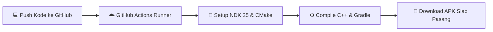

<div align="center">

# 🤠 LEGO® Indiana Jones™ 2: The Adventure Continues
### 🏺 Proyek Native Android Port (NDK C++17 & OpenGL ES 3.0) 🏺

*"Fortune and glory, kid. Fortune and glory."*

---

[](https://android.com)
[](https://www.khronos.org/opengles/)
[](https://developer.android.com/ndk)
[-FFD700.svg?style=for-the-badge&logo=playstation&logoColor=black)](https://en.wikipedia.org/wiki/Lego_Indiana_Jones_2:_The_Adventure_Continues)
[](.github/workflows/build-apk.yml)

<br/>

**Siapkan topi Fedora dan cambuk andalanmu! Bawa petualangan legendaris Dr. Henry Jones Jr. menjelajahi 4 film klasik langsung ke genggaman ponsel Android — 100% Native, cepat, dan mandiri tanpa aplikasi emulator pihak ketiga.**

[🌟 Fitur Utama](#-fitur-utama-true-adventurer) • [🏛️ Arsitektur Arkeologi](#-arsitektur-arkeologi-mesin-game) • [🎒 Ekspedisi Aset](#-ekspedisi-persiapan-aset-game) • [⚡ Build APK di Cloud](#-membangun-relik-apk-via-github-actions) • [🕹️ Tata Letak Kontrol](#-tata-letak-virtual-gamepad-touchscreen) • [📜 Piagam Kebijaksanaan](#-piagam-kebijaksanaan--disclaimer)

---

</div>

<br/>

## 🌟 Fitur Utama ("True Adventurer")

* ⚡ **Murni Native NDK (Zero Emulator App Overhead)**:
  Dibangun menggunakan arsitektur **Android NativeActivity (C++17)**. Biner berjalan langsung pada prosesor ARM ponsel Anda tanpa perlu membuka emulator eksternal.
* 🧱 **High-Level Emulation (HLE) Host Layer**:
  Menerjemahkan *syscalls* PSP secara langsung ke Android: manajemen memori virtual RAM 56 MB, *file stream loader* arsip `legoindy2psp.fib`, serta pembacaan input joystick.
* 💎 **Adaptive Cinema Viewport (16:9 Letterbox)**:
  Tampilan rasio asli PSP (480x272) disesuaikan secara otomatis ke layar ponsel modern (18:9, 19.5:9, 20:9 AMOLED) dengan bingkai latar dinamis tanpa distorsi gambar.
* 🪢 **Virtual Fedora & Bullwhip Gamepad**:
  Kontrol sentuh multi-touch transparan di layar lengkap dengan **Analog Stick 360°**, tombol aksi berwarna PlayStation (*Cross, Circle, Triangle, Square*), *D-Pad*, dan *Shoulder Triggers* (*L/R*).
* ☁️ **GitHub Actions Cloud Foundry**:
  Kompilasi otomatis APK langsung di cloud GitHub setiap kali ada pembaruan kode. Anda tidak perlu mengunduh puluhan gigabyte Android Studio & NDK di komputer!

---

## 🏛️ Arsitektur Arkeologi Mesin Game

Proyek ini terstruktur rapi ke dalam modul-modul modular:

```text
📦 LEGO Indiana Jones 2 (ANDROID)
 ├── 📜 README.md                    # Catatan ekspedisi & dokumentasi ini
 ├── 📜 .gitignore                   # Menjaga artefak rahasia & copyright tetap aman
 ├── ⚙️ copy_assets.ps1              # Mantra PowerShell untuk menyalin data game
 ├── ⚙️ build.gradle.kts             # Konfigurasi Gradle utama
 ├── 📂 .github/workflows/
 │    └── 🚀 build-apk.yml           # Mesin otomatis pembuat APK di awan GitHub
 └── 📂 app/
      ├── ⚙️ build.gradle.kts        # Skrip kompilasi NDK Clang (arm64-v8a / armeabi-v7a)
      └── 📂 src/main/
           ├── 📜 AndroidManifest.xml # Gerbang aplikasi Fullscreen Landscape
           ├── 📂 assets/             # Kuil penyimpanan artefak (legoindy2psp.fib)
           └── 📂 cpp/
                ├── 📄 CMakeLists.txt     # Blueprint kompilasi C++ & library grafis
                ├── 🧱 native_main.cpp    # Jantung aplikasi: EGL, loop animasi & sentuhan
                ├── 🏺 psp_types.h        # Kamus hieroglif register & hardware PSP
                ├── 🗺️ psp_hle.h / .cpp   # Jembatan I/O file arsip data & memori
                ├── 🎨 psp_renderer_gl.*  # Kuas grafis OpenGL ES 3.0 & tata letak layar
                └── 🕹️ touch_controls.*   # Mekanisme controller analog & tombol sentuh
```

---

## 🎒 Ekspedisi: Persiapan Aset Game

Untuk menjalankan petualangan ini, game membutuhkan arsip data dari kepingan disc asli:

1. Pastikan Anda memiliki folder ekstraksi disc game di:  
   `D:\Game\LEGO Indiana Jones 2 The Adventure Continues` (berisi file `legoindy2psp.fib` di `PSP_GAME\USRDIR`).
2. Jalankan skrip pembantu otomatis dengan membuka PowerShell:
   ```powershell
   cd "D:\Game\LEGO Indiana Jones 2 (ANDROID)"
   .\copy_assets.ps1
   ```
3. Aset utama game akan secara otomatis disalin ke dalam direktori `app/src/main/assets/` dan siap dipaketkan ke dalam APK.

---

## ⚡ Membangun Relik APK via GitHub Actions

Tidak punya Android Studio di komputer? **Jangan khawatir!** Anda bisa memanfaatkan komputasi awan GitHub:



1. **Buat Repositori Baru** di [GitHub](https://github.com/new) (beri nama misalnya `lego-indy-2-android`).
2. **Kirim Kode ke GitHub**:
   ```bash
   cd "D:\Game\LEGO Indiana Jones 2 (ANDROID)"
   git remote add origin https://github.com/USERNAME/lego-indy-2-android.git
   git push -u origin main
   ```
3. **Ambil APK**: Buka tab **Actions** di GitHub Anda, klik proses build yang selesai, lalu unduh artefak **`LegoIndy2-Native-Debug-APK`**.

---

## 🕹️ Tata Letak Virtual Gamepad Touchscreen

Layar sentuh smartphone Anda dirancang menyerupai genggaman konsol petualangan:

```text
 ┌────────────────────────────────────────────────────────────────────────┐
 │ [ L ]                                                            [ R ] │
 │                                                                        │
 │        [▲]                                              (△)            │
 │     [◄]   [►]                                        (□)   (○)         │
 │        [▼]                                              (✕)            │
 │                                                                        │
 │     ╭───────╮                                                          │
 │     │   ●   │  ANALOG STICK                  [SELECT]   [START]        │
 │     ╰───────╯                                                          │
 └────────────────────────────────────────────────────────────────────────┘
```

* **Analog Stick (Bawah Kiri)**: Menggerakkan Indy mengarungi rawa Amazon, makam kuno, dan piramida Akator.
* **Tombol Aksi (Kanan)**:
  * **(✕) Cross**: Lompat melompati jurang dan perangkap lantai.
  * **(○) Circle**: Mengayunkan cambuk (*whip*) untuk bergelantungan atau menarik objek.
  * **(□) Square**: Memukul musuh atau merakit kembali balok-balok LEGO yang berserakan.
  * **(△) Triangle**: Mengganti karakter aktif (Marion, Mutt, Sallah, dll).
* **[L] & [R]**: Menembak, melempar objek, atau aksi khusus kendaraan.

---

## 📜 Piagam Kebijaksanaan & Disclaimer

> [!IMPORTANT]
> Proyek ini adalah studi rekayasa perangkat lunak independen (*educational reverse engineering & wrapper framework*). 
> * **Aset Hak Cipta**: Seluruh aset audiovisual, nama karakter, dan konten permainan adalah hak cipta milik **Lucasfilm Ltd., LEGO Group, dan TT Games / Warner Bros. Games**. 
> * Repositori ini **tidak mendistribusikan berkas komersial berhak cipta**. Pengguna diwajibkan menyediakan salinan sah dari media permainan yang mereka miliki secara legal.

---

<div align="center">
  <sub>Ditempa dengan ❤️ dan balok LEGO untuk para penjelajah dunia di seluruh nusantara.</sub>
</div>
